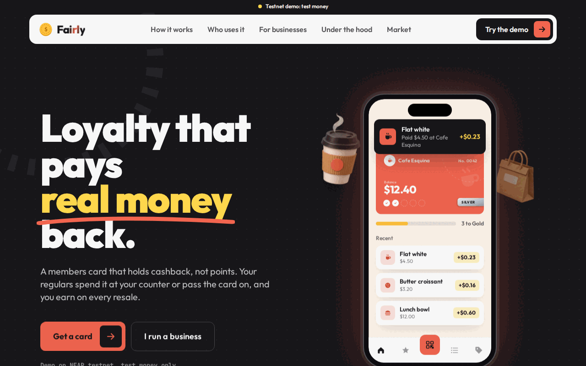
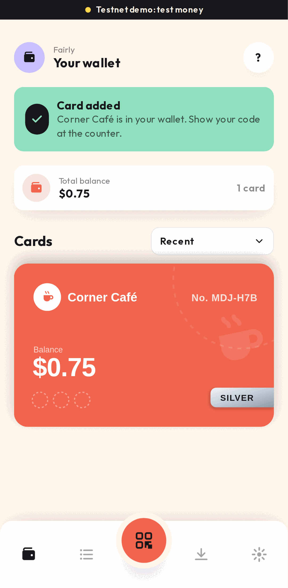
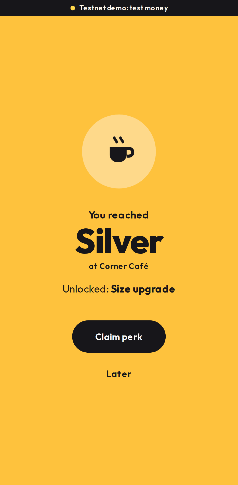
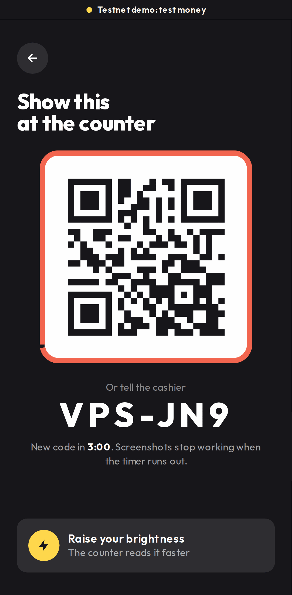
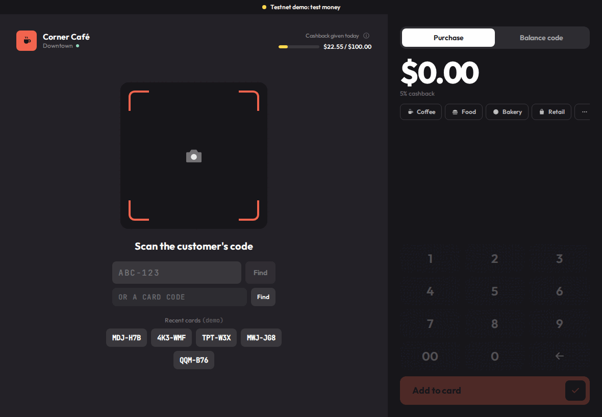
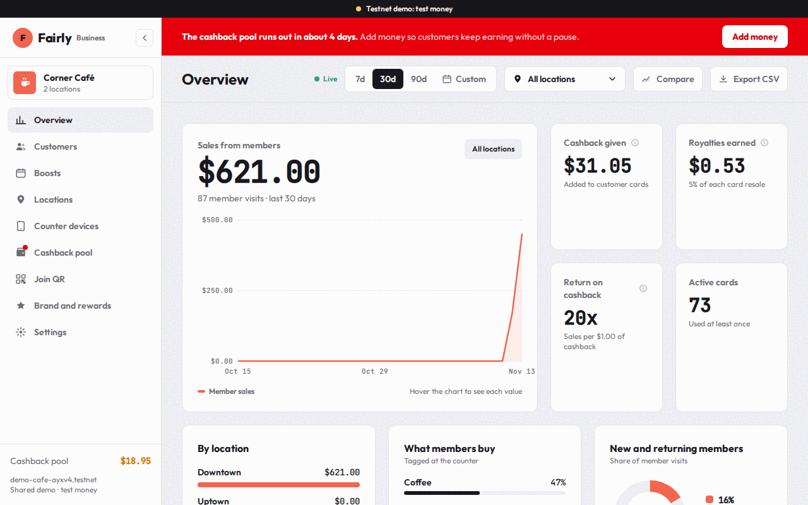
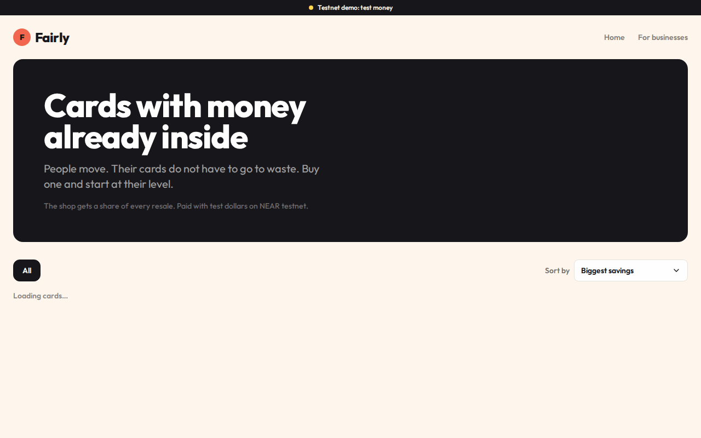
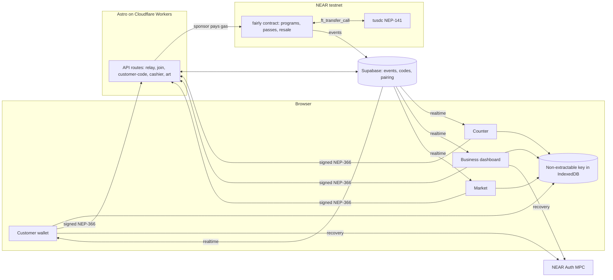

# Fairly: loyalty cards that hold real value

> Built at NEAR HACKATHON 2026. Tracks: **NFTs That Do Something** (`nfts`), **Real-World Money** (`realworld`).
> Testnet only. "tUSDC" is a test stablecoin, no real money is involved.

Demo: https://fairly.disenoapps.dev · Video: <VIDEO_URL> · Contracts: `fairly-ayxv4.testnet`, `tusdc-ayxv4.testnet`



## The problem
Paper stamp cards and closed loyalty apps give customers points that are rarely redeemed, expire, and are worth nothing outside the store. Small merchants cannot afford loyalty platforms.

## What Fairly is
Every loyalty card is an NFT on NEAR that holds its own balance:
- The merchant funds a cashback pool in a stablecoin.
- Each purchase moves cashback from the pool into the customer's card.
- The card levels up (Bronze, Silver, Gold) and its artwork changes.
- The customer can spend the balance at the merchant or sell the card on a market. Balance and level move with it, and the merchant earns a royalty on every resale.
- Customers and merchants need no wallet extension and never see gas: the account is created in the browser and a sponsor pays the fees.

## Try it
Production: https://fairly.disenoapps.dev. Everything runs on NEAR testnet with test money. There are two separate paths: a guided demo with shared sample data, and the real thing with your own business.

### Quick demo (5 minutes)
Start at https://fairly.disenoapps.dev/demo. The café, its dashboard and its counter are shared demo accounts; your card and your market listing are real testnet NFTs.
1. Get a card at Cafe Esquina (`/join/cafe-esquina`) → your wallet opens with the card.
2. Open the demo counter (`/cashier/cafe-esquina`), scan or type your wallet code and record a purchase (use a second device or tab) → your card shows the cashback.
3. See the sample business dashboard (`/business/cafe-esquina`) → 60 days of sample data.
4. Sell your card on the market (`/market`) → your card is listed with its balance and level.

### Use it for real (testnet)
1. Register your business at `/business/new` → your dashboard opens, with an empty pool and no sample data.
2. Connect your counter: pair a phone or tablet from your dashboard → the device shows your counter.
3. Your customers scan your QR and get your card → it appears in their wallet and earns cashback.

## Walkthrough
Everything runs on NEAR testnet; use two browser windows (or a phone and a laptop) to see both sides.

### 1. Customer: get a card and a counter code
1. Open `/join/cafe-esquina` from the quick demo and tap **Get my card** → a card from the demo business "Corner Café" appears in your wallet at `/wallet`, with a 0.00 balance.
2. Open the card and tap **Simulate a purchase** (demo business only) a few times → the balance rises live, the tier jumps to Silver and then Gold, a full-screen level-up shows and the artwork changes.
3. Back in the wallet tap **Show my code** → a QR and a typed code appear, rotating every three minutes and on each visit. This is what the cashier scans or types.

| Wallet | Level up | Customer code |
|---|---|---|
|  |  |  |

### 2. Counter: the cashier records a purchase
1. In another window open `/cashier/cafe-esquina` (step 2 of the quick demo).
2. Type the customer's code (or scan the QR) → the customer's card appears.
3. Enter an amount on the keypad and confirm → the customer's wallet updates live with the cashback.
4. To spend balance, the customer taps **Use balance** on the card and reads out a balance code; the cashier types it → the discount is honored and the balance drops.



### 3. Business: set up in minutes
1. Open `/business` and choose **Start your business** on the landing page (or open the demo dashboard at `/business/cafe-esquina`, which shows sample activity labeled "Sample data"; its cards and balances are real testnet data).
2. Follow the wizard: name, web address, type, cashback, boosts, a location on the map and the starting pool.
3. The dashboard opens with sales, customers, the cashback pool and runway. Under **Connect a device**, the counter tablet shows a short code at `/cashier/<your-slug>`; type it in the dashboard to pair the device.
4. **Pause** the device from the dashboard → the tablet goes back to "Connect this device".



### 4. Market: resale with a royalty
1. In the wallet open a card and tap **Sell this card**, set a price and **List for sale**.
2. In another window open `/market` → the listing appears with its balance, level and savings.
3. Tap the listing, then **Buy** → the buyer receives the card with its balance and level; the seller receives the price minus the shop's royalty, and the shop receives the royalty.



### 5. Recovery with email (NEAR Auth)
1. When the wallet offers **Keep your wallet safe**, tap **Protect with email** → approve in the NEAR Auth window.
2. On a new browser open the wallet and choose **Recover with email** → the cards come back with their balances. Businesses do the same from Settings.
3. Email recovery runs locally on `http://localhost:3000` (see Run locally). NEAR Auth only allows approved web origins, and the hosted demo runs on a temporary domain, so it offers the backup file (**Back up my wallet**) instead. Email recovery goes live once the official domain exists and NEAR Auth approves it.

## How NEAR is used
| What | How |
|---|---|
| NFT with a balance (NEP-171, 177, 181, 199) | The card, not the wallet, owns the cashback. Transferring the card moves balance and level. `nft_payout` returns the merchant royalty. |
| Stablecoin (NEP-141) | `tusdc` is a test token with a faucet. The pool is funded and cards are bought with `ft_transfer_call`. |
| Meta-transactions (NEP-366) | Customer and merchant actions are signed in the browser and relayed by a sponsor, which pays the gas. The relay only accepts an allowlist of methods. |
| Function-call access keys | The cashier device can only record purchases, capped per location per day. It cannot touch the pool. |
| Non-extractable keys | Keys are WebCrypto Ed25519 keys created non-extractable in IndexedDB: the page can sign, no script can read the key. |
| NEAR Auth (MPC) | Email recovery adds a second key derived by NEAR Auth's MPC network. Fairly stores the public key, never the email. |
| Events (NEP-297) | Every state change emits an event; Supabase mirrors them for live screens. |
| Sponsored accounts | New customers get an implicit account funded by the sponsor, no wallet install. |

## Architecture


Details: `docs/architecture.md`, decisions in `docs/decisions.md`, requirements with ids in `specs/`.

## Run locally
Requires only Docker. Full instructions are in `DEVELOPMENT.md`.

```bash
cp .env.example .env
docker compose build dev
docker compose run --rm supabase start
docker compose run --rm dev pnpm -C app install
docker compose run --rm --service-ports dev pnpm -C app dev
```

Fill `.env` with testnet accounts and the Supabase keys first (names only are in `.env.example`). Then open http://localhost:3000. Deploy and seed the contracts with `./scripts/deploy` and `./scripts/seed`, and check a running app with `./scripts/smoke <base_url>`.

## Conventions
- Spec-driven: behavior lives in `specs/` with requirement ids; test names carry the ids.
- Docker only: nothing is installed on the host. Testnet only.
- No secrets in git; keys live in `.env` (ignored) and the NEAR CLI credentials volume.
- Strict TypeScript without `any`, `pnpm -C app check` at 0 errors; Rust errors are stable string codes.
- No comments in code; decisions are logged in `docs/decisions.md`.
- Commits are past tense and impersonal, for example `Added cashback calculation on purchase (BUY-003)`.

## Test coverage
| Layer | Count | What it covers |
|---|---|---|
| Contract unit tests (Rust, `cargo test`) | 68 (64 `fairly`, 4 `tusdc`) | Programs, cashiers and managers, passes and tiers, purchases and cashback, daily caps, boosts, redeem and perks, resale and royalties, expiry, events |
| Browser E2E (Playwright in Docker, real testnet) | 29 tests (28 run on the dev server, 1 checks the content security policy on a production build) | Customer join, wallet and rotating code, counter lookup and purchase, balance codes, issue a card on the spot, business setup, device pairing and pause, manager invite, resale with royalty, non-extractable keys and backup restore, home screen shortcuts, service worker, intro slides and level-up |
| Smoke script | 1 script | Routes, manifest, RPC view call, CSP (`scripts/smoke`) |
| Type check | `astro check` | Astro, Vue and TypeScript files including the E2E specs |

Run them with `docker compose run --rm dev sh -c "cd contracts && cargo test"` and `docker compose run --rm e2e test` (see `DEVELOPMENT.md`). The content security policy check only runs against a production build.

## Built with
| Area | Libraries |
|---|---|
| Contracts | `near-sdk` 5.30.1, `near-contract-standards` 5.30.1, `cargo-near` 0.23, Rust stable (`wasm32-unknown-unknown`) |
| CLI | `near-cli-rs` 0.31 |
| Web app | Astro ^7.4 with `@astrojs/cloudflare` ^14.4 and `@astrojs/vue` ^7.1, Vue ^3.5, Tailwind CSS ^4.3 |
| NEAR in the browser | `near-api-js` 7.4.0, `borsh` 2.0.0, `@auth0/auth0-spa-js` ^2.30 (NEAR Auth) |
| Data and realtime | `@supabase/supabase-js` 2.119.0, Supabase CLI (local stack) |
| UI helpers | `leaflet` 1.9.4 (maps), `uqr` 0.1.3 (QR codes) |
| Tooling | pnpm, TypeScript ^6.0, `@astrojs/check`, Wrangler ^4.150, Playwright 1.65.0 |
| Infrastructure | Docker, Cloudflare Workers, Supabase |

## Data and keys
- **Keys stay on the device and cannot be copied.** Customers, businesses, managers and counter devices each get their own NEAR key, created in their browser as a non-extractable WebCrypto key: the page can sign with it, but no script can read it. The server never receives a private key. A device or manager is connected by typing a short code that only carries its public account id, the same pattern TVs use to sign in.
- **Losing a phone or clearing the browser.** Balances and history live on chain and in the event log, not on the device. A backup file holds a separate recovery key added to the account; restoring it on a new browser brings the card or business back. A lost counter device is paused from the dashboard and a new one is paired.
- **Content security policy.** Production pages only run scripts from Fairly itself (hashed), and only talk to the NEAR RPC, Supabase and the map services.
- **Email for account recovery.** Customers and businesses can link an email or Google login with NEAR Auth (FastAuth) so they can get back into their account on a new device. NEAR Auth's MPC network holds a second key for the account; Fairly stores only that public key and the account id, never the email. In this testnet build it works on `http://localhost:3000`; on the hosted demo it is enabled once the official domain is approved by NEAR Auth.
- **What Fairly stores off chain.** Supabase keeps a copy of public contract events (for live screens and history), used balance codes, and short-lived pairing codes. All of it is testnet data.

## Business model
- Post-pay: a merchant starts with a small deposit (from $20). Cashback above the pool waits as Pending on the customer's card, cannot be redeemed or resold yet, and becomes Available when the merchant settles, normally weekly ("Settle now" on the dashboard).
- Planned fees, charged in the weekly settlement and never to the customer: 3% / 2% / 1.5% on cashback generated and about $0.03 per card issued, with network cost folded in (proposed, not on chain yet).
- Who pays what, per-user and per-card costs, monthly network cost with 0% and 50% existing users, and the merchant budget: `docs/business-model.md`.

## Project documents
- Product: `docs/product.md`
- Architecture: `docs/architecture.md`
- Decisions: `docs/decisions.md`
- Specifications: `specs/`
- Plan and status: `TASKS.md`

## License
MIT: see `LICENSE`.
