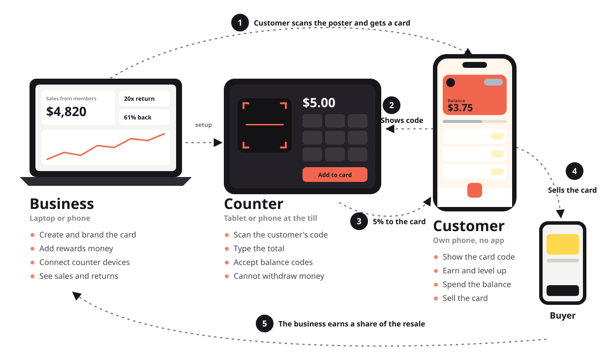
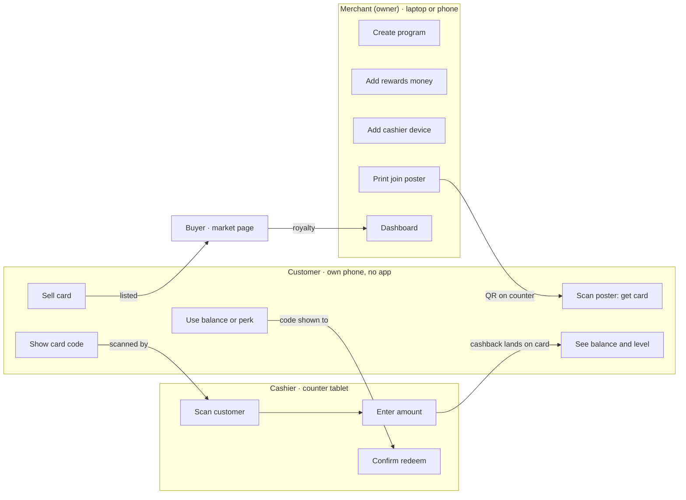

# Who uses what

Three people touch Fairly, plus a buyer for resales. Each gets only the screens they need.

Text version:

| | Merchant | Cashier | Customer | Buyer |
|---|---|---|---|---|
| Device | Laptop or phone | Shared counter tablet | Own phone browser | Any browser |
| Sign-in | NEAR wallet (testnet) | Device key set up by merchant | None (card created in browser) | None for browsing |
| Sees | Program settings, rewards money, stats, devices | Scanner, keypad, today's total | Card, balance, level, perks, sell | Cards for sale, value inside, price |
| Cannot | n/a | Withdraw money, change settings, exceed daily limit | See other cards | n/a |
